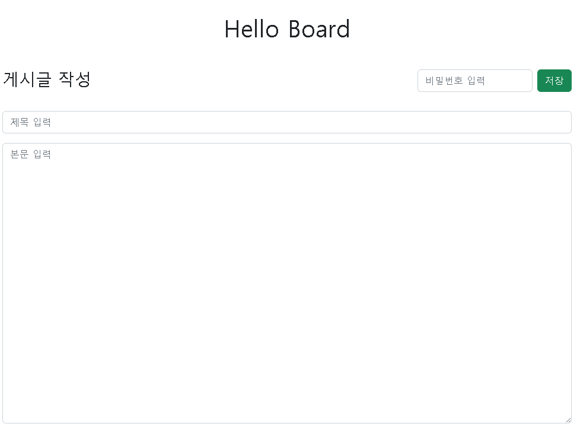

# README

# 1. 프로젝트 소개

- 스프링, 스프링 부트, JPA 등을 학습한 후 실습을 위해 진행하는 프로젝트
- CRUD 기능만을 가지고 있는 간단한 게시판 만들기

# 2. 기술 스택

### Backend

- Spring Boot
- Spring MVC
- JPA / Spring Data JPA

### Frontend (Server-Side Rendering)

- Thymeleaf
- Bootstrap

### Database

- MySQL

### Test

- JUint (JUnit5)

# 3. 주요 기능

### create



- 제목, 본문, 비밀번호 입력 후 저장 버튼을 눌러 게시글 생성 가능


- 제목과 비밀번호는 필수로 입력해야 하며 미입력 시 게시글 생성 불가

### read


- 게시글은 15개씩 페이지 분할하여 리스트로 볼 수 있으며, 기본적으로 최신순으로 게시글이 정렬된다.


- 게시글 리스트에서 특정 게시글을 클릭하면 해당 게시글의 제목, 본문, 게시글 작성 시간을 확인할 수 있는 페이지로 이동한다.

### update


- 게시글 읽기 페이지에서 수정 버튼을 누르면 제목과 본문이 유지된 상태로 수정 페이지로 이동한다.


- 제목 또는 본문을 수정한 후 비밀번호를 정확하게 입력하고 수정 버튼을 누르면 게시글이 수정되며 수정한 게시글 읽기 페이지로 이동하고 기존의 게시글 작성 시간이 수정한 시간으로 변경된다.

### delete


- 게시글 읽기 페이지에서 비밀번호를 정확하게 입력하고 삭제 버튼을 누르면 게시글이 삭제된다.

# 4. 실행 방법

### 1. 프로젝트 클론

```jsx
git clone https://github.com/seungjig/simple-board.git
cd simple-board
```

### 2. 자바 & 빌드 도구 버전 확인

- Java 21
- Spring Boot 3.5
- Gradle 8.14

### 3. 데이터베이스 설정

```jsx

spring.datasource.url=jdbc:mysql://localhost:3306/board?serverTimezone=Asia/Seoul&characterEncoding=UTF-8
spring.datasource.username=root
spring.datasource.password=<yourpassword>

spring.jpa.hibernate.ddl-auto=create
spring.jpa.show-sql=true
spring.jpa.database-platform=org.hibernate.dialect.MySQLDialect
```

> **spring.jpa.hibernate.ddl-auto=create 설정으로 인해 실행 시마다 스키마를 새로 생성하니 주의**

### 4. 프로젝트 실행

**Gradle**

```jsx
./gradlew bootRun
```

### 5. 브라우저에서 접속

```jsx
http://localhost:8080/article/list
```

# 5. 프로젝트 구조

### 패키지 구조

```jsx
src
└── main
    ├── java
    │   └── com.example.simple_board
    │       ├── config
    │       │     └── JpaAuditingConfig          # JPA Auditing 설정
    │       │
    │       ├── exception                        # 초기 예외 처리 했다가 Validation
    │       │     ├── NotCorrectDto              # 으로 변경해서 예외 사용 X
    │       │     └── NotCorrectPasswordException
    │       │
    │       ├── model
    │       │     ├── dto
    │       │     │     ├── ArticleDto           # 게시글 요청/응답 DTO
    │       │     │     └── DeletedForm          # 삭제 요청 DTO
    │       │     └── Article                    # 게시글 Entity
    │       │
    │       ├── repository
    │       │     └── ArticleRepository          # Spring data jpa 사용
    │       │
    │       ├── service
    │       │     └── ArticleService             # 게시글 비즈니스 로직 처리
    │       │
    │       └── web
    │             └── ArticleController          # 게시글 Controller
    │
    └── resources
        ├── templates                            # thymeleaf 탬플릿
        │     ├── article-add.html
        │     ├── article-content.html
        │     ├── article-list.html
        │     └── article-update.html
        │
        └── application.properties
```
