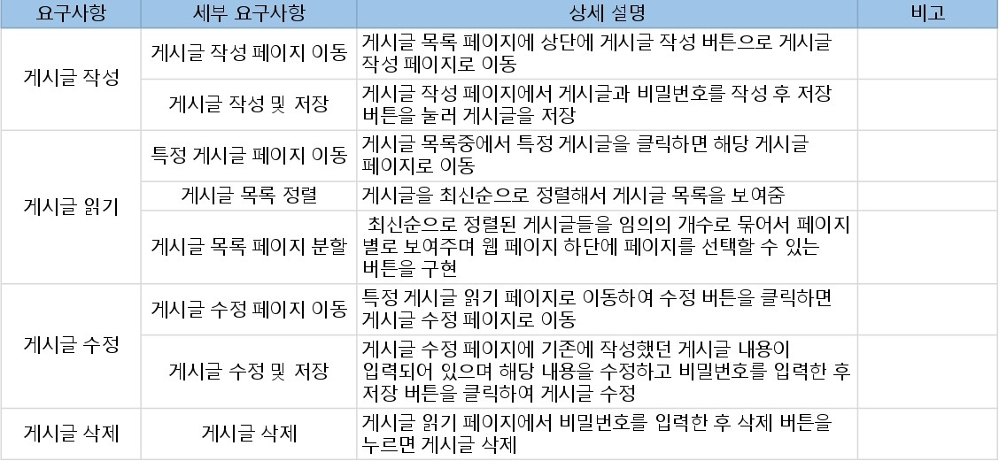

# 프로젝트 개요 및 요구사항 정의

# 프로젝트 개요

## 1. 프로젝트 목표

- 게시글을 작성, 읽기, 수정, 삭제가 가능한 웹 페이지 만들기

## 2. 기술 스택

- Spring, SpringBoot, Java, JPA, SpringDataJPA, MySQL, HTML, CSS, Bootstrap, Thymeleaf

## 3. 참여 인원

- 1인( 본인)

## 4. 배경

- 스프링 프레임 워크 생태계와 JPA, SpringDataJPA, Querydsl등을 학습한 후 CRUD 기능만이 있는 웹 게시판을 만들어 학습한 내용을 적용해보기 위함

# 요구사항 정의

